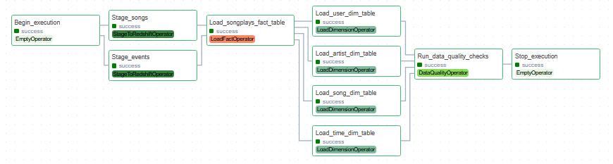

# Sparkify data pipeline (Airflow + Redshift)

Udacity Data Pipelines project. The DAG pulls Sparkify's JSON event logs and song metadata from S3 into Redshift Serverless, builds a star schema from them, and then runs a few data quality checks on the result.



## The DAG

`Begin_execution` → `Stage_events` and `Stage_songs` → `Load_songplays_fact_table` → the four dimension loads (users, songs, artists, time) → `Run_data_quality_checks` → `Stop_execution`

It runs every hour with catchup off. Tasks don't depend on past runs, retry 3 times with 5 minutes between tries, and don't send an email on retry.

## Files

- `dags/final_project.py` - the DAG and task order
- `plugins/operators/` - the four custom operators
- `plugins/helpers/sql_queries.py` - the SELECT statements Udacity provided for the fact and dimension tables
- `create_tables.sql` - run once in Redshift before the first DAG run
- `docker-compose.yaml` - Airflow 2.8.1 for running everything locally

## Operators

**StageToRedshiftOperator** empties a staging table and loads it with a `COPY` from S3. The table, bucket, key, JSON format option, region and connection ids are all passed in from the DAG. `s3_key` is a templated field, so a key like `log-data/{{ logical_date.year }}/{{ logical_date.month }}/` would only pick up the files for that run's month, which is what you'd want for backfills.

**LoadFactOperator** inserts into the fact table. It only appends, since fact tables tend to get big.

**LoadDimensionOperator** inserts into a dimension table. With `mode="truncate-insert"` (the default) it empties the table first. With `mode="append"` it keeps what's already there.

**DataQualityOperator** takes a list of checks, each one a SQL query, the expected result and optionally a comparison like `>`. It runs every check, logs the results, and raises an error if any of them fail, so the task retries and then fails.

All SQL runs through Airflow's `PostgresHook`, and the AWS keys for `COPY` come from the `aws_credentials` connection.

Checks currently in the DAG:

- `songplays` and `users` aren't empty
- no NULL keys in `songplays`, `users`, `songs`, `artists` or `time`

## Running it

1. Copy the data into your own bucket, in the same region as your Redshift workgroup. The Udacity bucket is in us-west-2.

   ```
   aws s3 sync s3://udacity-dend/log-data/ s3://<your-bucket>/log-data/ --source-region us-west-2 --region us-east-1
   aws s3 cp s3://udacity-dend/log_json_path.json s3://<your-bucket>/ --source-region us-west-2 --region us-east-1
   aws s3 sync s3://udacity-dend/song-data/A/A/ s3://<your-bucket>/song-data/A/A/ --source-region us-west-2 --region us-east-1
   ```

   I only used `song-data/A/A/`. Copying the full song set kept cutting out in CloudShell, and the subset is enough to test the pipeline. To load everything, set `SONG_DATA_KEY` to `song-data/` in `dags/final_project.py`. Either way, change `S3_BUCKET` to your bucket name.

2. Create a Redshift Serverless workgroup. Make it publicly accessible and allow inbound TCP 5439 in its security group, otherwise Airflow running on your machine can't reach it. Then run `create_tables.sql` in Query Editor v2.

3. Start Airflow:

   ```
   docker compose up -d
   ```

   Then go to http://localhost:8080 and log in with `airflow` / `airflow`.

4. Add two connections under Admin > Connections:
   - `aws_credentials` - type Amazon Web Services, with the access key ID and secret of an IAM user that can read S3
   - `redshift` - type Postgres, host is the workgroup endpoint (without `:5439/dev`), database `dev`, port `5439`, plus your Redshift user and password

5. Turn on `final_project`. It starts a run for the latest hour straight away. Turn it off once it's done, because the fact load is append-only and every extra hourly run inserts the same songplays again.

Keys and passwords only live in the Airflow connections. Nothing secret is stored in this repo.
